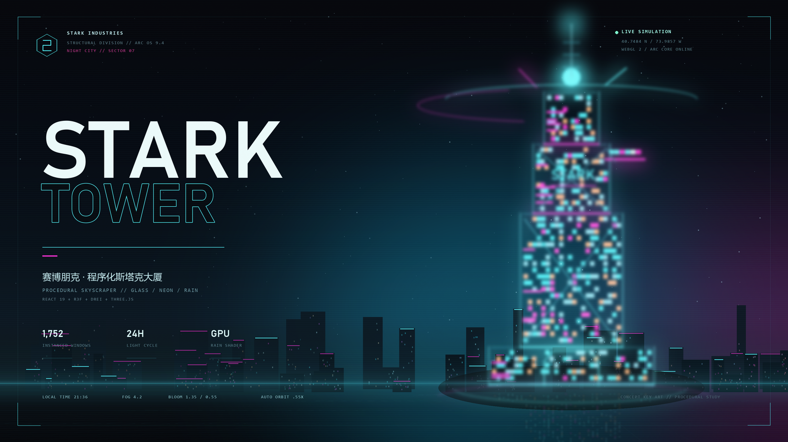

<div align="center">



<h1>STARK TOWER // NIGHT CITY</h1>

<p><strong>一个程序化生成、可实时调节的赛博朋克「史塔克大厦」WebGL 场景</strong></p>

<p>
  <a href="https://jay-victor.github.io/STARK-TOWER-NIGHT-CITY/"><strong>◉ LIVE DEMO</strong></a>
  &nbsp;·&nbsp;
  <a href="https://github.com/Jay-Victor/STARK-TOWER-NIGHT-CITY">GitHub Repository</a>
  &nbsp;·&nbsp;
  <a href="#快速开始">快速开始</a>
</p>

<p>
  
  
  
  
  
  <a href="https://github.com/Jay-Victor/STARK-TOWER-NIGHT-CITY/actions/workflows/deploy-pages.yml">
    
  </a>
</p>

<p><sub>概念主视觉由项目脚本程序化绘制；实际浏览器内效果包含实时光照、反射、雨滴和 Bloom。</sub></p>

</div>

---

## 项目简介

**STARK TOWER // NIGHT CITY** 是一个完全程序化的赛博朋克塔楼场景，所有建筑几何、窗户、机械结构、天空、霓虹招牌、雨滴和环境反射均由代码生成，不依赖外部 3D 模型、HDR 文件或远程字体。

打开页面即进入默认的 **21:36 夜景模式**：

- 88 单位高的分层塔楼、玻璃幕墙、悬挑观景舱、机械塔冠与天线；
- 1,752 扇塔楼窗户、城市窗户与结构细节全部使用 `InstancedMesh` 批量渲染；
- EffectComposer Bloom、ACES 色调映射、暗角和胶片颗粒；
- Drei Environment + Lightformer 构成可离线使用的程序化城市光环境；
- MeshReflectorMaterial 潮湿地面反射、程序化沥青纹理与积水；
- 6,200 个 GPU 雨滴粒子；
- OrbitControls 自动环绕，以及完整的 Leva 实时调试面板；
- 桌面与移动端响应式 HUD。

## 技术栈

| 分类 | 技术 |
| --- | --- |
| UI / 交互 | React 19.3、TypeScript 5.9、Leva 0.10 |
| 3D 渲染 | Three.js 0.186、React Three Fiber 9.8、Drei 10.7 |
| 后期处理 | @react-three/postprocessing 3.2、postprocessing 6.39 |
| 构建 | Vite 7 |
| 视觉资产 | 100% 浏览器 Canvas / Shader 程序化生成 |
| 部署 | GitHub Actions → GitHub Pages |

## 快速开始

环境要求：

- Node.js `^20.19.0` 或 `>=22.12.0`
- 支持 WebGL 2 的现代浏览器（Chrome / Edge / Firefox / Safari）
- 建议开启硬件加速

```bash
git clone https://github.com/Jay-Victor/STARK-TOWER-NIGHT-CITY.git
cd STARK-TOWER-NIGHT-CITY
npm install
npm run dev
```

打开终端提示的地址，默认：

```text
http://127.0.0.1:5173/
```

请不要直接双击 `index.html` 打开，项目需要通过 Vite 服务器运行。

### 常用命令

```bash
npm run dev         # 本地开发
npm run typecheck   # TypeScript 类型检查
npm run build       # 生产构建
npm run build:pages # GitHub Pages 子路径构建
npm run preview     # 预览生产包
```

## 交互与调试

### 镜头

- **左键拖动 / 单指滑动**：360° 环绕
- **滚轮 / 双指缩放**：拉近拉远
- 默认开启自动环绕；可在 Leva 的 `CAMERA RIG` 分组中关闭或调速
- 相机不会进入地面以下，避免穿地

### Leva 面板

右上角 **STARK // CONTROL** 面板：

| 分组 | 参数 | 说明 |
| --- | --- | --- |
| `TIME SYSTEM` | `LOCAL TIME` / `LIGHT GAIN` | 0–24 小时昼夜光照调色板；全局光强增益 |
| `NEON SIGNAL` | `CYAN SIGNAL` / `MAGENTA SIGNAL` | 整体霓虹主色，实时影响塔楼、城市、点光与招牌 |
| `ATMOSPHERE` | `FOG DENSITY` | 指数雾浓度 |
| `BLOOM FX` | `INTENSITY` / `THRESHOLD` / `SMOOTHING` / `RADIUS` | Bloom 强度与阈值等完整参数 |
| `WEATHER` | `RAIN SYSTEM` / `RAIN DENSITY` / `SURFACE WETNESS` | 雨滴开关、雨量、地面反射湿度 |
| `CAMERA RIG` | `AUTO ORBIT` / `ORBIT SPEED` | 自动环绕与速度（默认折叠） |

推荐参数：

- **霓虹夜景**：时间 `21:30`，Bloom 阈值约 `0.55`；
- **黄昏**：时间 `18:20`；
- **黎明**：时间 `06:20`；
- **镜面湿地面**：`SURFACE WETNESS` 接近 `1.0`；
- **通透远景**：降低 `FOG DENSITY`。

## 项目结构

```text
.
├── .github/workflows/deploy-pages.yml   GitHub Pages 自动部署
├── public/
│   ├── favicon.svg
│   └── og-cover.png                     README 概念主视觉
├── scripts/
│   └── generate-cover.py                可选的封面生成脚本（Pillow）
├── src/
│   ├── App.tsx                          Canvas / HUD / Leva / 错误边界
│   ├── main.tsx
│   ├── styles.css                       HUD、启动动画、响应式布局
│   ├── types.ts
│   ├── hooks/
│   │   └── useSceneControls.ts          Leva schema → 强类型 SceneSettings
│   ├── lib/
│   │   ├── palette.ts                   24 小时调色板、太阳方向
│   │   ├── random.ts                    确定性 PRNG
│   │   └── textures.ts                  招牌、广告牌、湿沥青 Canvas 贴图
│   └── components/
│       ├── scene/
│       │   ├── Scene.tsx                场景组装根
│       │   ├── Tower.tsx                塔楼材质、Arc Reactor、光环、天线
│       │   ├── towerData.ts             程序化几何与 1,752 扇实例化窗户
│       │   ├── InstancedMeshes.tsx      通用 InstancedMesh / WindowField
│       │   ├── Ground.tsx               反射地面、积水、地面霓虹
│       │   ├── City.tsx                 城市楼群、广告牌、空中车流
│       │   ├── Lighting.tsx             日光 / 月光 / 霓虹点光
│       │   ├── Atmosphere.tsx           FogExp2 与大气浓度
│       │   ├── SkyDome.tsx              程序化天空 Shader
│       │   ├── EnvironmentRig.tsx       Drei 环境反射
│       │   ├── Rain.tsx                 GPU 雨滴 Shader
│       │   ├── Effects.tsx              Bloom / Vignette / Noise / ACES
│       │   └── CameraRig.tsx            OrbitControls
│       └── ui/
│           ├── Hud.tsx                  科幻 HUD
│           ├── SceneErrorBoundary.tsx   WebGL 失败回退界面
│           └── levaTheme.ts
├── index.html
├── package.json
├── tsconfig*.json
└── vite.config.ts
```

## 实现细节

### 程序化塔楼与实例化

塔楼由三段错位的玻璃体量、裙楼、悬挑舱、机械塔冠、外露斜撑与天线组成。重复结构通过 `InstancedMesh` 合并：

- 塔楼窗户：**1 个 draw call / 1,752 扇窗户**
- 幕墙竖框、楼层横梁：1 个实例化批次
- 结构块、角柱、机械格栅：1 个实例化批次
- 斜撑：1 个实例化批次
- 青色 / 品红霓虹灯带：各 1 个实例化批次
- 城市楼体、城市窗户、屋顶灯、车流：分别批处理

窗户颜色通过 `instanceColor` 写入，高亮 HDR 色彩参与 Bloom。

### 昼夜调色板

`palette.ts` 包含从深夜、黎明、正午、黄昏到夜晚的 10 个关键帧。时间滑块实时插值：

- 天空顶部色 / 地平线色 / 辉光色 / 星空强度；
- 太阳方向、颜色、强度与阴影开关；
- ambient / hemisphere 光色；
- 雾的颜色与霓虹灯强度。

### 潮湿地面

`MeshReflectorMaterial` 生成平面反射，再叠加：

- 程序生成的深色沥青 color map；
- bump map 与 roughness map；
- 湿润度控制的反射强度、模糊、扰动；
- 高光积水层与地面霓虹标线。

### 环境光

为满足 PBR 玻璃的反射需求，项目使用 Drei `Environment` + `Lightformer` 构建可离线运行的程序化城市光环境。它等价于自建城市 HDR，不使用远程 CDN。

如需改用远程预设：

```tsx
<Environment preset="city" background={false} environmentIntensity={0.9} />
```

并移除 `EnvironmentRig.tsx` 内的 Lightformer 子节点即可。

### 雨滴

`Rain.tsx` 使用自定义 `ShaderMaterial` 在顶点着色器内计算每滴雨的下落、风偏移、点大小与深度淡出；通过 `drawRange` 控制雨量，CPU 每帧只更新时间 uniform。

## 性能说明

- 窗口、结构、城市、车流、灯带均批量实例化，避免重复 draw call；
- Canvas DPR 限制为 `[1, 1.75]`；
- 阴影仅由太阳光投影，夜间自动关闭；
- 点光源不投影；
- `MeshReflectorMaterial` 会额外渲染一次场景，这是湿地反射的主要成本；
- 低端设备建议：将 `Ground.tsx` 的反射分辨率从 1024 降为 512，并将 `Effects.tsx` 的 `multisampling` 降为 0 或 2。

## GitHub Pages 部署

仓库已包含 [deploy-pages.yml](./.github/workflows/deploy-pages.yml)：

1. 推送到 `main` 分支；
2. GitHub Actions 自动执行 `npm ci` 与 `npm run build:pages`；
3. 构建产物部署至 GitHub Pages。

如果首次部署失败，请进入：

```text
Repository Settings → Pages → Build and deployment → Source: GitHub Actions
```

然后重新运行 workflow。

在线地址：

**https://jay-victor.github.io/STARK-TOWER-NIGHT-CITY/**

## 生成主视觉（可选）

`public/og-cover.png` 已包含在仓库中。如需重新生成：

```bash
pip install pillow numpy
npm run cover:generate
```

脚本默认读取 Windows 字体（Bahnschrift / Consolas / 微软雅黑）；在其他系统上可自行替换 `scripts/generate-cover.py` 内的字体路径。

## 浏览器兼容

推荐 Chrome / Edge 最新版并开启硬件加速。项目使用 WebGL 2、浮点后期帧缓冲和实时着色器。如果 WebGL 初始化失败，页面会显示可操作的错误回退界面而不是黑屏。

## License

[MIT](./LICENSE) © 2026 Jay-Victor

> STARK / 史塔克等名称属于 MARVEL 相关权利方。本项目为非商业的粉丝风格技术演示。
